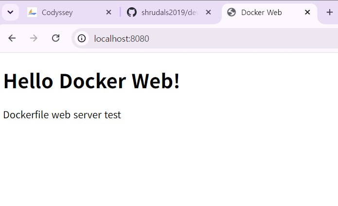

# Development Workstation Setup

## 1. 프로젝트 개요

Windows 환경에서 WSL2 Ubuntu, Docker Desktop, Git, GitHub, VS Code를 이용해 개발 워크스테이션을 구성하고 검증한 기록이다.

이번 수행에서는 다음 항목을 확인했다.

- Linux CLI 기본 조작
- 파일/디렉터리 권한 변경
- Docker 설치 및 기본 동작 확인
- Docker 이미지/컨테이너 실행 및 로그 확인
- Dockerfile 기반 커스텀 웹 서버 이미지 빌드
- 포트 매핑
- Bind Mount
- Docker Volume 영속성
- Git 로컬 버전 관리
- GitHub 공개 저장소 연결 및 Push
- VS Code의 WSL Ubuntu 연결
- 실제 오류 3건에 대한 문제 해결


---

## 2. 실행 환경

| 항목 | 값 |
|---|---|
| Host OS | Windows |
| Linux 환경 | WSL2 |
| Ubuntu | 26.04.1 LTS |
| Shell | Bash (`/bin/bash`) |
| Git | 2.53.0 |
| Docker CLI | 29.9.2 |
| Docker Engine | 29.9.2 |
| Docker Desktop | 4.98.0 |
| Architecture | x86_64 |
| GitHub 사용자 | `shrudals2019` |
| GitHub 저장소 | https://github.com/shrudals2019/dev-workstation |

---

## 3. 수행 체크리스트

- ✅ WSL2 Ubuntu 설치 및 실행
- ✅ Linux 사용자 및 Bash 환경 확인
- ✅ Git 설치 상태 확인
- ✅ Docker Desktop 설치
- ✅ Docker Desktop과 WSL Ubuntu 연동
- ✅ `docker --version`, `docker info` 검증
- ✅ `hello-world` 컨테이너 실행
- ✅ `docker images`, `docker ps`, `docker ps -a` 확인
- ✅ Ubuntu 컨테이너 실행
- ✅ 실행 중 컨테이너에 `docker exec`로 진입
- ✅ 메인 프로세스 종료와 컨테이너 종료 관계 확인
- ✅ `docker logs` 확인
- ✅ Dockerfile 작성
- ✅ 커스텀 이미지 `dev-web:v1` 빌드
- ✅ 포트 매핑 `8080:80`
- ✅ Bind Mount 변경 전/후 확인
- ✅ Docker Volume 생성
- ✅ 컨테이너 삭제 후 Volume 데이터 유지 확인
- ✅ `docker stats` 확인
- ✅ Linux 터미널 기본 조작
- ✅ 파일/디렉터리 권한 변경
- ✅ Git 전역 사용자 설정
- ✅ Git 저장소 초기화 및 첫 커밋
- ✅ GitHub 공개 저장소 연결 및 Push
- ✅ VS Code WSL Ubuntu 연결
- ✅ Source Control에서 저장소 인식

---


> 주요 명령어와 검증 결과는 README 본문에 요약해 두었고, 화면 증거는 `evidence/` 폴더에 별도 이미지 파일로 분리했다.


## 4. 프로젝트 구조

```text
dev-workstation/
├── README.md
├── Dockerfile
├── app/
│   └── index.html
├── terminal-practice/
│   ├── .hidden.txt
│   ├── empty.txt
│   ├── file1.txt
│   └── permission.txt
└── evidence/
    ├── github-public-repository.png
    ├── github-public-settings.png
    ├── vscode-wsl-connected.png
    ├── terminal-practice.png
    ├── docker-images-ps.png
    └── port-mapping-browser.png
```

> 포트 매핑 브라우저 검증 이미지는 실제 `http://localhost:8080` 주소창과 웹페이지가 함께 보이는 캡처를 별도로 추가하는 것이 가장 안전하다.

---

## 5. 터미널 및 권한 실습

터미널 실습에서는 다음을 수행했다.

- `pwd`로 현재 경로 확인
- `ls`, `ls -la`로 일반/숨김 파일 확인
- `mkdir`, `touch`로 폴더/파일 생성
- `echo`, `cat`으로 파일 내용 작성/확인
- `cp`로 복사
- `mv`로 이동 및 이름 변경
- `rm`, `rmdir`로 삭제
- `cd`로 경로 이동

권한 실습:

- 파일: `600` → `644`
- 디렉터리: `700` → `755`

결과:

```text
-rw-------  ->  -rw-r--r--
drwx------  ->  drwxr-xr-x
```

`r = 4`, `w = 2`, `x = 1`이며 `644`, `755`는 이 값을 조합한 숫자 권한이다. 예를 들어 `644`는 소유자 권한 `4+2=6`(읽기·쓰기), 그룹 권한 `4`(읽기), 기타 사용자 권한 `4`(읽기)를 뜻한다.

명령 실행 증거는 `evidence/terminal-practice.png`에 추가한다. `mkdir`와 `touch`는 성공해도 기본적으로 출력이 없으므로, 생성 명령과 이어지는 `ls -la terminal-practice` 결과를 한 화면에 담아 파일이 만들어진 것을 확인한다.

```bash
mkdir -p terminal-practice
touch terminal-practice/file1.txt
ls -la terminal-practice
```

> 아래 캡처는 위 명령을 실제로 실행한 터미널 화면으로 교체한다.
>
> 


---

## 6. Docker 기본 검증

Docker CLI와 Engine이 정상 동작함을 확인했다.

주요 검증:

```text
Docker version 29.9.2
Server Version: 29.9.2
Operating System: Docker Desktop
Kernel: WSL2
```

`hello-world` 실행 결과:

```text
Hello from Docker!
This message shows that your installation appears to be working correctly.
```

또한 다음 명령으로 이미지와 컨테이너 상태를 확인했다. `docker images`는 로컬 이미지 목록을, `docker ps -a`는 실행 중이거나 종료된 모든 컨테이너를 보여준다. 아래 명령을 다시 실행해 실제 결과를 확인하고 터미널 캡처를 함께 보관한다.

```bash
docker images
docker ps -a
```

이미지 목록에서는 `dev-web:v1`, 컨테이너 목록에서는 `ubuntu-run`, `dev-web`, `bind-web` 등의 이름과 상태를 확인한다. 실행 순서나 정리 여부에 따라 목록은 달라질 수 있으므로 제출할 때는 본인 터미널의 실제 출력으로 기록한다.


추가 확인 명령:

```bash
docker ps
docker logs attach-test
docker stats --no-stream
```


---

## 7. Ubuntu 컨테이너와 exec

실행 중인 Ubuntu 컨테이너:

```bash
docker run -dit --name ubuntu-run ubuntu sleep infinity
```

실행 중 컨테이너에 진입:

```bash
docker exec -it ubuntu-run bash
```

컨테이너 내부에서:

```bash
ls
echo "Hello Docker Container"
```

을 실행했다.

`docker exec`로 실행한 bash를 종료해도 메인 프로세스 `sleep infinity`가 계속 실행 중이므로 컨테이너는 유지되었다.

반면 `bash` 자체를 메인 프로세스로 실행한 `attach-test` 컨테이너는 `exit` 시 메인 프로세스가 끝나면서 컨테이너도 `Exited (0)` 상태가 되었다.

---

## 8. Dockerfile과 커스텀 웹 서버

`Dockerfile`:

```dockerfile
FROM nginx:alpine
COPY app/index.html /usr/share/nginx/html/index.html
EXPOSE 80
```

빌드:

```bash
docker build -t dev-web:v1 .
```

결과:

```text
[+] Building 6.6s (8/8) FINISHED
naming to docker.io/library/dev-web:v1
```

이미지 목록에서 `dev-web:v1` 생성도 확인했다. 이미지와 컨테이너는 역할이 다르다. 이미지는 실행에 필요한 파일과 설정을 담은 템플릿이며, 컨테이너는 이미지를 실행한 인스턴스다. 예를 들어 `dev-web:v1`은 이미지이고 `--name dev-web`으로 실행한 웹 서버가 컨테이너다. 컨테이너 안에서 생긴 변경은 이미지에 자동 반영되지 않으며, 컨테이너를 지우고 같은 이미지로 새 컨테이너를 만들 수 있다.

---

## 9. 포트 매핑

웹 서버 컨테이너 실행:

```bash
docker run -d --name dev-web -p 8080:80 dev-web:v1
```

`docker ps` 결과:

```text
0.0.0.0:8080->80/tcp
```

의미:

```text
`Host 8080 → Container 80 → Nginx`
```

컨테이너는 자체 네트워크 네임스페이스에서 호스트와 분리된 네트워크 인터페이스와 포트를 사용한다. `-p 8080:80`은 호스트의 8080 포트 요청을 컨테이너의 80 포트로 전달해 격리된 서비스에 접속하게 한다.

검증 주소:

```text
http://localhost:8080
```

브라우저에서 `http://localhost:8080`을 열어 페이지가 표시되는지 확인한다. 아래 캡처에는 브라우저 주소창과 응답 페이지가 함께 보여야 한다.



### 포트 충돌 진단 및 해제

`docker run`에서 `port is already allocated` 오류가 나면 먼저 호스트의 8080 포트를 사용하는 프로세스나 컨테이너를 확인한다. WSL Ubuntu에서는 다음 명령을 사용할 수 있다.

```bash
sudo ss -ltnp | grep ':8080'
docker ps --filter publish=8080
```

프로세스가 점유 중이면 `ss` 결과의 PID를 확인하고, 종료해도 되는 프로세스인지 확인한 뒤 종료한다. Docker 컨테이너가 점유 중이면 해당 컨테이너를 확인하고 중지한다.

```bash
sudo kill PID_NUMBER
docker stop CONTAINER_NAME
```

`PID_NUMBER` 또는 `CONTAINER_NAME`은 확인한 실제 값으로 바꿔 입력한다. 사용 중인 프로세스를 확인하지 않고 강제 종료하지 않는다. 해제 후 `sudo ss -ltnp | grep ':8080'` 또는 `docker ps --filter publish=8080`으로 다시 확인한다. 포트가 비었으면 실행을 재시도한다. 다른 호스트 포트 사용도 가능하다. 예: `-p 8082:80`이면 `http://localhost:8082`로 접속한다.

---

## 10. Bind Mount

실행:

```bash
docker run -d --name bind-web -p 8081:80 -v "$PWD/app:/usr/share/nginx/html:ro" nginx:alpine
```

변경 전:

```text
Hello Docker Web!
Dockerfile web server test
```

호스트의 `app/index.html`을 수정한 뒤 다시 요청했을 때:

```text
Bind Mount Changed!
```

로 즉시 변경되었다.

이미지를 다시 빌드하거나 컨테이너를 재생성하지 않고도 호스트 파일 변경이 컨테이너에 반영됨을 확인했다. 명령의 `$PWD/app`은 현재 프로젝트 경로를 기준으로 한 상대 경로이므로 프로젝트 폴더에서 실행해야 한다. 상대 경로는 저장소를 다른 위치에 clone해도 명령을 재사용하기 쉽지만, 실행 위치가 다르면 대상 경로도 달라질 수 있다. 절대 경로는 실행 위치와 무관하게 대상을 분명히 지정하지만 사용자별 경로를 포함하면 다른 컴퓨터에서 수정이 필요하다. 이 과제에서는 clone 위치에 맞춰 재현하기 쉽도록 상대 경로를 사용했다. `:ro`는 컨테이너에서 마운트 내용을 읽기 전용으로 사용한다는 뜻이다.

---

## 11. Docker Volume 영속성

Volume 생성:

```bash
docker volume create mission-data
```

데이터 저장:

```text
persistent data
```

기존 컨테이너 삭제:

```bash
docker rm volume-write
```

새 컨테이너에서 동일 Volume을 연결한 뒤:

```text
persistent data
```

가 다시 확인되었다.

즉, 컨테이너를 삭제해도 Docker Volume의 데이터는 유지되는 것을 검증했다.

---

## 12. Git / GitHub

Git 설정:

```text
user.name  = shrudals2019
user.email = shrudals2019@users.noreply.github.com
branch     = main
```

저장소 초기화와 첫 커밋:

```text
f3fd21b Initial development workstation setup
```

원격 저장소:

```text
https://github.com/shrudals2019/dev-workstation.git
```

GitHub 공개 저장소에 Push한 뒤 웹 페이지에서 `Dockerfile`, `app/`, `terminal-practice/`가 업로드된 것을 확인했다.

관련 증거:

- `evidence/github-public-settings.png`
- `evidence/github-public-repository.png`

---

## 13. VS Code와 WSL Ubuntu

처음에는 VS Code가 Windows Local 모드로 열려 `Download Git for Windows`가 표시되었다.

Git은 WSL Ubuntu에 설치되어 있었으므로 Microsoft WSL 확장을 설치한 뒤 Ubuntu에 연결했다.

최종적으로 VS Code 왼쪽 아래에:

```text
WSL: Ubuntu
```

가 표시되는 상태에서 프로젝트를 열었다.

관련 증거:

- `evidence/vscode-wsl-connected.png`

---

# 14. Troubleshooting

## 1) WSL Ubuntu 설치 실패

### 문제

```powershell
wsl --install -d Ubuntu
```

실행 시:

```text
Wsl/InstallDistro/WININET_E_NAME_NOT_RESOLVED
서버 이름이나 주소를 확인할 수 없습니다.
```

오류가 발생했다.

### 원인 가설

Ubuntu 배포판 다운로드 과정에서 서버 주소를 정상적으로 해석하지 못한 네트워크/DNS 계열 문제로 판단했다.

### 확인

명령줄 설치가 진행되지 않았고 Ubuntu 배포판이 정상 설치되지 않은 상태였다.

### 해결

Microsoft Store에서 Ubuntu를 직접 설치했다.

설치 후:

```bash
uname -s
cat /etc/os-release
whoami
echo "$SHELL"
```

을 실행해 Ubuntu 26.04.1 LTS, Linux, Bash 환경이 정상임을 확인했다.

---

## 2) Ubuntu에서 Docker 명령 미인식

### 문제

```bash
docker --version
```

결과:

```text
docker: command not found
```

### 원인 가설

Docker Desktop은 Windows에 설치되어 있었지만 WSL Ubuntu와 Docker CLI가 연결되지 않은 상태라고 판단했다.

### 확인

Ubuntu 터미널에서 Docker 명령 자체를 찾지 못했다.

### 해결

Docker Desktop의 WSL Integration을 활성화하고 Ubuntu와 연결했다.

이후:

```text
Docker version 29.9.2
```

가 정상 출력되었다.

---

## 3) Docker API 소켓 권한 오류

### 문제

WSL Integration 이후:

```bash
docker info
```

실행 시:

```text
permission denied while trying to connect to the docker API at unix:///var/run/docker.sock
```

오류가 발생했다.

### 원인 가설

Docker Engine 자체 문제보다 일반 사용자 `nkm`의 Docker 소켓 접근 권한 문제로 판단했다.

### 확인

```bash
sudo docker info
```

를 실행하자 Server 정보가 정상적으로 출력되었다.

따라서 Docker Engine은 정상이고 사용자 권한 문제임을 확인했다.

### 해결

```bash
sudo usermod -aG docker $USER
```

로 사용자를 Docker 그룹에 추가한 뒤 PowerShell에서:

```powershell
wsl --shutdown
```

을 실행했다.

Ubuntu를 다시 열고 `sudo` 없이:

```bash
docker info
```

를 실행했을 때 Client와 Server 정보가 모두 정상 출력되어 해결을 확인했다.

---

## 15. 검증 파일 위치

### 상세 터미널/도커/Git 로그

```text
evidence/terminal-practice.png
evidence/docker-images-ps.png
```

### GitHub 공개 저장소 증거

```text
evidence/github-public-settings.png
evidence/github-public-repository.png
```

### VS Code WSL 연결 증거

```text
evidence/vscode-wsl-connected.png
```

### 추가로 반드시 확보 권장

```text
evidence/port-mapping-browser.png
```

이 파일은 실제 브라우저에서 `http://localhost:8080` 주소창과 웹페이지가 함께 보이도록 캡처한 이미지여야 한다. 위 경로의 이미지 파일은 실제 실행 화면을 캡처해 `evidence/` 폴더에 저장해야 README에서 정상 표시된다.

---

## 16. Git과 GitHub의 차이

- **Git**: 로컬에서 파일 변경 이력을 관리하는 버전 관리 도구
- **GitHub**: Git 저장소를 온라인에 저장하고 공유하는 서비스

정리:

```text
Git    = 버전 관리
GitHub = 원격 저장소 및 협업 서비스
```

---

## 17. 최종 결과

이번 수행을 통해 다음 개발 환경을 구성했다.

```text
Windows
└─ WSL2 Ubuntu 26.04.1 LTS
   ├─ Bash
   ├─ Git 2.53.0
   ├─ Docker CLI 29.9.2
   │  └─ Docker Desktop 4.98.0 / Engine 29.9.2
   └─ VS Code WSL
```

수행 흐름:

```text
Linux CLI
→ 권한
→ Docker 설치/검증
→ 이미지와 컨테이너
→ Dockerfile
→ 포트 매핑
→ Bind Mount
→ Volume
→ Git
→ GitHub
→ VS Code WSL
```

최종 공개 저장소:

**https://github.com/shrudals2019/dev-workstation**
